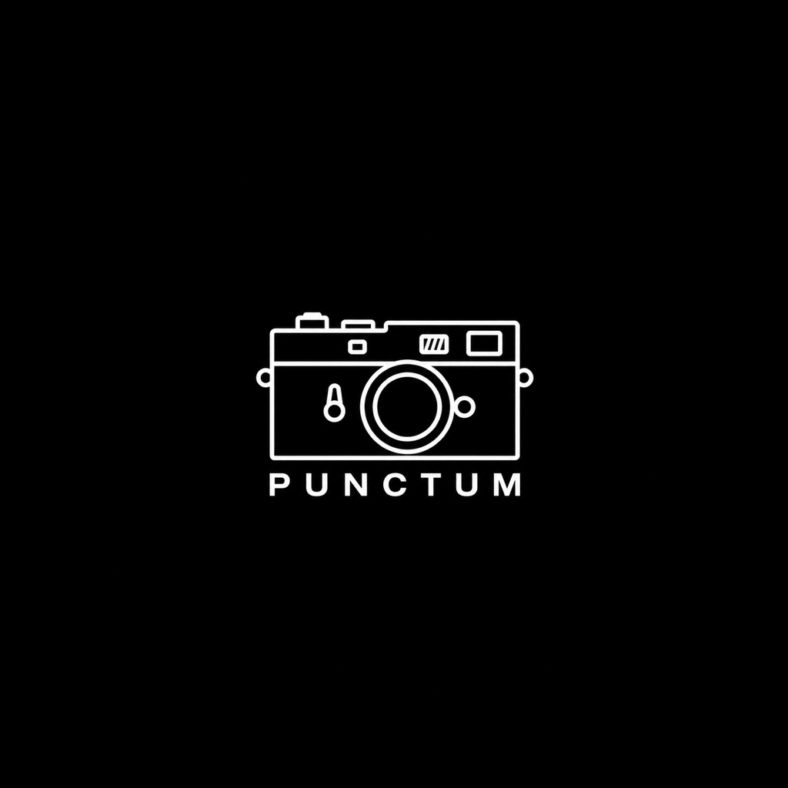

<p align="center">
  
</p>

<h1 align="center">Punctum · 观止</h1>

<p align="center"><strong>为回看而生的影像画廊</strong></p>

> **Punctum 是一款致力于为影像爱好者提供充足情绪价值的软件。你可以像翻阅一本大师摄影杂志一样，浏览和回看自己的作品，并通过自然的手势快速取舍、整理照片，让每一次回望都重新感受到影像的重量。**

我们希望把相册从普通的图片容器，变成一座属于每个人自己的影像画廊。照片保留原本的比例、拍摄时间、地点和影像参数，以更接近摄影画册与展览的方式被重新观看；首页、画廊和大图页也围绕“浏览、感受、取舍”这条路径展开。

Punctum 直接映射设备里的系统图集，照片仍由系统相册管理。你可以把不同主题的照片分别组织成一座座画廊，在回看中完成筛选、移动与删除。


## 当前版本 · 2026-10-30

| 平台 | 版本 / 构建号 | 当前内容 |
|---|---|---|
| Android | **0.7.0 / 77** | 黑色120胶片；开灯时亮部过曝、暗部保留，逐渐恢复原色 |
| iOS | **0.5.10 / 60** | 保持 10 月 10 日版本，本轮未移植 Android 选片台 |

**0.7.0正式锁版**：用户已确认最终120胶片与手动开灯过曝效果。以已验收/76实现构建0.7.0/77；当前正式包 `APK/Punctum-0.7.0-release.apk`。新对话先读 [2026-10-30交接](SESSION_HANDOFF_2026-10-30.md)，发布与GitHub同步核验见 [发布记录](docs/RELEASE_VALIDATION_2026-10-30.md)。iOS未改。

## 反转胶片的新观看方式

进入图集后，上方是有织纹、褶皱和晕影的深色投影幕布，下方是延伸至系统导航区域的白色发光选片台。看大图与选片在同一页完成。

- **先选片，再投影**：默认空幕布，中央轻显“选择一张胶片，重映一段时光”；点击胶片以 **1.2 秒**开片、亮起和轻展开。左右横滑或点屏幕边缘可直接快切。
- **手动点亮选片台**：每次进入保持中性暗态，小缩图隐约显影；点击标题右侧的横向实体开关才开灯，无自动等待。光先涌入产生过曝，再于约 2.4 秒内平滑回落到稍暗的中性白（232/232/230），照片恢复原色。再次点击关灯；更多菜单位于投影区右上方，避开竖图，菜单自身样式保持原样。系统禁用动画时，手动开灯直接显示终态。
- **六张一页的选片台**：3 列 × 2 行，横向整页切换；保留最新在前的拍摄/编辑排序。缩略图中心裁成正方形，黑色 120 边框沿用参考样图的比例、橙色 PUNCTUM 800 与三角标记；随机双位数稳定随片，底部显示全图集照片序号，保留轻微角度。
- **完整呈现画幅**：投影区高度固定，图像按比例适配；横图与 EXIF 共用左右 24dp 边距，竖图拥有独立高度预算。
- **沉浸与留白**：进入胶片图集隐藏顶部状态栏，退出恢复；移除底部 LIGHT TABLE、页码整行，将 44dp 高度交给投影区。标题区收紧，胶片上提，底部增加 20dp 留白。
- **按需查看影像信息**：右上角“更多”切换 EXIF，开启后跨换片保持；参数在图像下方空隙中居中，需要让位时图像中心最多上移 18dp。
- **统一整理删除**：各模式列表按住完成立即弹观止确认，取消保留照片与当前投影；按住时右上角显示进度，中途松手取消。投影区上滑仍加入待删除并在退出图集回首页时统一确认，描述为“被删除的项目将会进入系统相册回收站”。
- **简洁图集片签**：居中名称与精简年月/数量，左返回、右手动开关，更多位于屏幕右上；排序切换后菜单保持展开，重命名仍打开原改名框。

反转胶片首页保持现有封面；四张堆叠与黑色片基仅做过设计探索，用户决定暂不修改。明信片和票据模式沿用原有列表/大图体验；本轮新选片台暂未提供旧大图的缩放和 Motion Photo 播放入口。

## 其他核心体验

- 直接映射系统图集，保留作品原比例、真实拍摄时间、地点和影像参数。
- 首页支持明信片、票据、反转胶片三种邀请卡；支持多选添加图集、重命名与顺序调整。
- 常规大图支持 1–5 倍保留缩放、单指移动、双击复原与快速取舍。
- Android Motion Photo / iOS Live Photo 在各自原有大图页播放；iOS 支持拍摄、编辑、同步三种排序及后台恢复。

## 验证与交付

Android 本次 Release、Lint（0 错误、17 条既有警告）、**44 项单元测试**、签名检查通过。当前包为 `APK/Punctum-0.6.0-film-lamp-soft.apk`（/69），已保留数据安装 PJW110 并拉回核对哈希一致；[开灯验证](docs/ANDROID_FILM_LAMP_VALIDATION_2026-10-26.md)。此前 /67 见 [边缘修复验证](docs/ANDROID_FILM_EDGE_VALIDATION_2026-10-26.md)，/65 见 [选片台记录](docs/ANDROID_IMMERSIVE_FILM_VALIDATION_2026-10-26.md)。10 月 22 日删除验证见 [列表删除记录](docs/ANDROID_LIST_DELETE_CONFIRM_VALIDATION_2026-10-22.md)。

用户确认与开发验证分别记录。既有设备上的空幕布、原比例适配、快切、分页、参数常驻、排序菜单、按住删除及退出统一确认/取消均有记录；本轮实际删除验证仅使用独立创建的临时测试图，未删除用户原照片。历史帧统计只代表对应设备和版本，不能用于承诺所有图库零卡顿。

GitHub 保存源码、资源、测试、版本配置与文档。APK/IPA、签名资料、本机配置、用户照片和原始设备截图日志不纳入仓库。本次不更新 NAS。

## 本地开发

### Android

使用 Android Studio 打开仓库根目录。包名 `com.punctum.gallery`，最低 Android 8.0（API 26），目标 API 35。使用 JDK 17：

```sh
./gradlew :app:assembleDebug
./gradlew :app:assembleRelease :app:lintRelease :app:testDebugUnitTest
```

Release 需要本机 `punctum-release.jks`，以及 `local.properties` 中的 `PUNCTUM_STORE_PASSWORD`、`PUNCTUM_KEY_PASSWORD`；签名资料和配置通过安全方式单独迁移。

### iOS

工程位于 `iOS/Punctum`，最低 iOS 17，Bundle Identifier `com.chessyyq.punctum`。必要时运行 `xcodegen generate`；未签名 IPA 构建脚本为 `iOS/Punctum/scripts/build-unsigned-ipa.sh`。签名证书与描述文件单独迁移。本轮未重建或安装 iOS。

## 文档与源码入口

- [当前更新索引](CHANGELOG.md) · [Android 日志](changelog/android.md) · [iOS 日志](changelog/ios.md)
- [最新交接](SESSION_HANDOFF_2026-10-23.md) · [10 月 22 日记录](SESSION_HANDOFF_2026-10-22.md) · [总交接](PUNCTUM_HANDOFF.md)
- [正式发布验证](docs/RELEASE_VALIDATION_2026-10-22.md) · [选片台迭代验证](docs/ANDROID_FILM_REVIEW_VALIDATION_2026-10-22.md)
- [设计与交互验证](design-qa.md) · [日志维护规则](changelog/README.md)
- [产品需求](PRD/PRD-Punctum观止.md)

Android 入口：`MainActivity.kt` 按风格路由，`FilmReviewScreen.kt` 实现幕布和选片台，`FilmReviewLayout.kt` 管理比例/参数避让/手势判断，`GalleryViewModel.kt` 协调待删除和退出。

历史版本、包与验收边界保留在带日期的日志和交接中，以本页及 2026-10-22 交接为当前入口。
