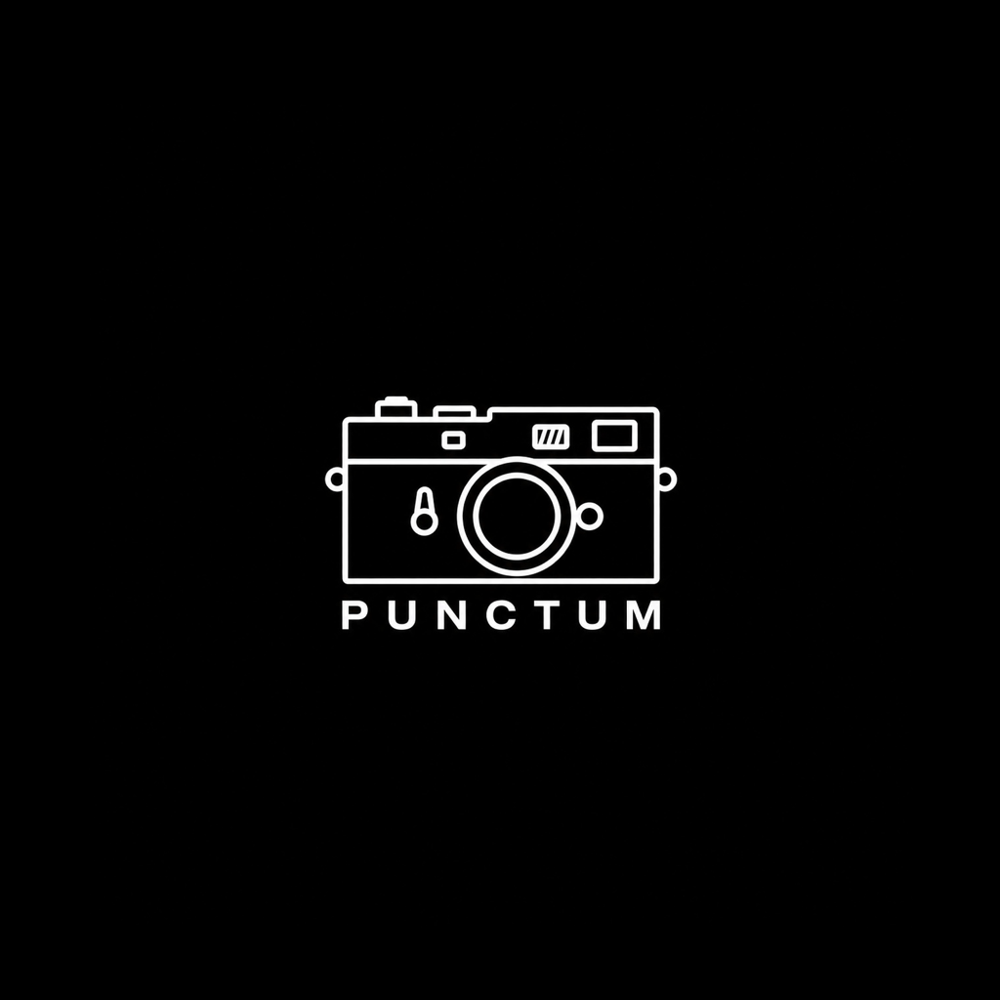

<p align="center">
  
</p>

<h1 align="center">Punctum · 观止</h1>

<p align="center"><strong>为回看而生的影像画廊</strong></p>

Punctum 直接映射设备里的系统图集，让照片以摄影画册与展览的方式被重新观看。保留作品原比例、拍摄时间、地点和影像参数，通过自然手势浏览、筛选与整理照片。

## 当前版本 · 2026-11-05

| 平台 | 版本 / 构建号 | 状态 |
|---|---|---|
| Android | **0.7.1 / 91** | 原图高清与快速切图体验已获用户验收；本次仅升号，正式构建与签名通过；GitHub 待发布核验 |
| iOS | **0.5.10 / 60** | 保持原版本，本轮未改源码或重新构建 |

**GitHub 待发布核验**：[0.7.1 Release](https://github.com/yyqlovelife/Punctum_YYQ/releases/tag/android-v0.7.1) · [签名 APK](https://github.com/yyqlovelife/Punctum_YYQ/releases/download/android-v0.7.1/Punctum-0.7.1-91.apk)。正式包已构建并验签；以上入口待远端发布后核验，APK 不进入源码树。新标签使用 `android-v0.7.1`；原 `android-v0.7.0` 标签继续保留 Android /77 锁版。

本次验收基于已安装诺贝尔手机的 **0.7.0/90 原图优化包**；临时测试媒体和画廊已清理。该包已通过 Google Drive 下载读回核对：[已验收 /90 历史下载](https://drive.google.com/file/d/184c7vu9ZlQlRyfNrYFIBf_jT-bzh-2GC/view?usp=drivesdk)。本轮仅发布 GitHub，未安排 /91 手机安装或更新 Google Drive。

当前进度以[11 月 5 日交接](SESSION_HANDOFF_2026-11-05.md)和[发布核验](docs/RELEASE_VALIDATION_2026-11-05.md)为准。

## 原图高清与快速切图

普通大图与胶片投影共用原图加载管线。默认画面按真实显示像素从原文件解码，移除固定 1800 像素上限；放大或超大、超长照片通过原图分块补足细节。小图保持自身分辨率。

- 当前图优先，提前准备左右各 5 张；限定并发、取消过期请求，并按照片修订状态更新缓存。
- 列表继续使用轻量缩略图路径，滚动停稳后准备大图，快速滑动时暂停后台准备。
- 原图分块兼容 EXIF 方向和透明图片，避免坐标错误、透明区域重复叠色。
- 胶片幕布纹理缓存复用，减少换片时重复绘制。界面保留已验收的颜色、布局与光影。

诺贝尔实测覆盖冷进入、列表快滑、连续快切、拖动分页、缩放、格式与删除取消。左右预取窗口记录达到 `11/11`。胶片拖动短样本 P95 从 32ms 降至 13ms，边缘快切从 77ms 降至 40ms；短样本仍存在掉帧，不能据此承诺所有设备和任意原图零耗时。详见[原图验证](docs/ANDROID_ORIGINAL_DETAIL_VALIDATION_2026-11-05.md)。

## 四张照片组成一卷首页

图集最新四张照片拼成通栏 120 胶片，下方使用原始纸纹片签。英文使用内置 Averia Serif Libre，中文使用思源宋体；标题黑色，时间和数量灰色。数量文案统一为 `Stories Behind xx Photographs`，明信片和票根使用各自英文标题字体。

首页以诺贝尔机型固定校准：三种模式首卡上沿一致，首屏完整呈现三卷及纸栏，第三条纸栏底部贴齐屏幕；不按屏幕高度自动均分。整卷点击保留下沉反馈。旧胶片首页及回退开关保留，凹印和替换字体试验保持停用。

首页进入图集前核对完整列表缓存，避免旧封面闪回；新照片高清缩略图成功后再替换当前画面，避免露出空底。封面请求有修订缓存键、限定解码尺寸和异步过期结果保护。

## 胶片投影与选片

上方为深色织纹幕布，下方为白色发光选片台，看大图与选片在同一页完成。

- 默认空幕布配文为 **观止，岂止于观**，无句号；选片后以 1.2 秒开片、亮起并轻展开。
- 横向拖动时照片跟手分页；左右边缘点按立即快切。向上拖动只抬起照片，保留删除圆钮与收拢动效，不显示教学提示语；实际删除在退出图集时统一确认。
- 投影支持 1–5 倍双指缩放、单指平移和双击还原，裁切边界为整个投影区域；下方选片台保持不动。缩放中暂停切图和上滑删除，还原后恢复。
- 选片台每页 3 列 × 2 行，保留 120 胶片边框、稳定编号和轻微角度。进入时保持可辨识的中性暗态，点击实体开关手动开灯；过曝后约 2.4 秒回落到中性白。系统禁用动画时直接显示终态。
- 图像完整保留原比例；更多菜单可切换 EXIF，参数状态跨换片保留。按住列表删除仍须确认，取消时保留照片和当前投影。

明信片、票据模式保留各自列表及大图体验。常规大图同样支持 1–5 倍缩放、平移和双击还原；Android Motion Photo 与 iOS Live Photo 保留各自原有大图播放入口。

## 验证与交付边界

已验收 /90 完成 Release、Lint（0 错误、17 条既有警告）、78 项单元测试与签名核验。设备 APK、云端读回包和本地包 SHA256 一致；22 张临时测试媒体及临时画廊已清理，其他媒体保留。

/91 的 Release、Lint（0 错误、17 条既有警告）、78 项单元测试与签名通过；与已验收 /90 逐项比较仅 AndroidManifest.xml 改动，DEX、资源和素材全部一致。正式包为 40,227,232 字节，SHA256 `3bf363a530f543ac15387e7dd48ac6594172ff5a510438b588b3fdccc6a8d974`。GitHub 提交、标签和 Release 附件仍待发布核验，由[发布核验记录](docs/RELEASE_VALIDATION_2026-11-05.md)单独记录。用户验收、设备安装和远端发布分别标注，不能互相替代。

GitHub 保存源码、资源、测试、版本配置与文档。APK/IPA、签名资料、本机配置、用户照片和原始设备截图日志不进入源码树。

## 本地开发

Android 使用 Android Studio 打开仓库根目录，JDK 17。包名 `com.punctum.gallery`，最低 API 26，目标 API 35。

```sh
./gradlew :app:assembleDebug
./gradlew :app:assembleRelease :app:lintRelease :app:testReleaseUnitTest
```

Release 使用本机 `punctum-release.jks` 与 `local.properties` 的签名配置，资料单独迁移。

iOS 工程位于 `iOS/Punctum`，最低 iOS 17，Bundle Identifier 为 `com.chessyyq.punctum`。必要时运行 `xcodegen generate`；未签名 IPA 构建脚本为 `iOS/Punctum/scripts/build-unsigned-ipa.sh`。

## 文档入口

- [更新索引](CHANGELOG.md) · [Android 日志](changelog/android.md) · [iOS 日志](changelog/ios.md)
- [最新交接](SESSION_HANDOFF_2026-11-05.md) · [总交接与历史](PUNCTUM_HANDOFF.md) · [本次发布核验](docs/RELEASE_VALIDATION_2026-11-05.md)
- [原图与快切验证](docs/ANDROID_ORIGINAL_DETAIL_VALIDATION_2026-11-05.md) · [投影缩放](docs/ANDROID_FILM_PROJECTION_ZOOM_VALIDATION_2026-11-04.md) · [性能与颜色](docs/ANDROID_FILM_PROJECTION_PERF_VALIDATION_2026-11-03.md)
- [设计与交互](design-qa.md) · [日志维护规则](changelog/README.md) · [产品需求](PRD/PRD-Punctum观止.md)

历史版本、安装包与验收边界保留在带日期的交接及验证记录中。
